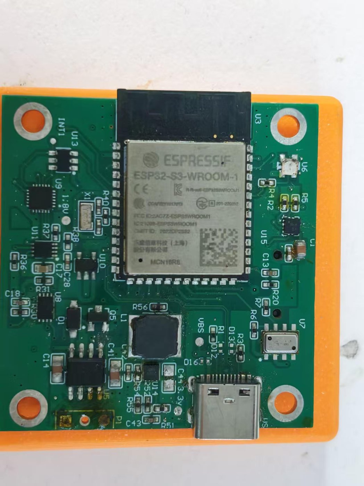
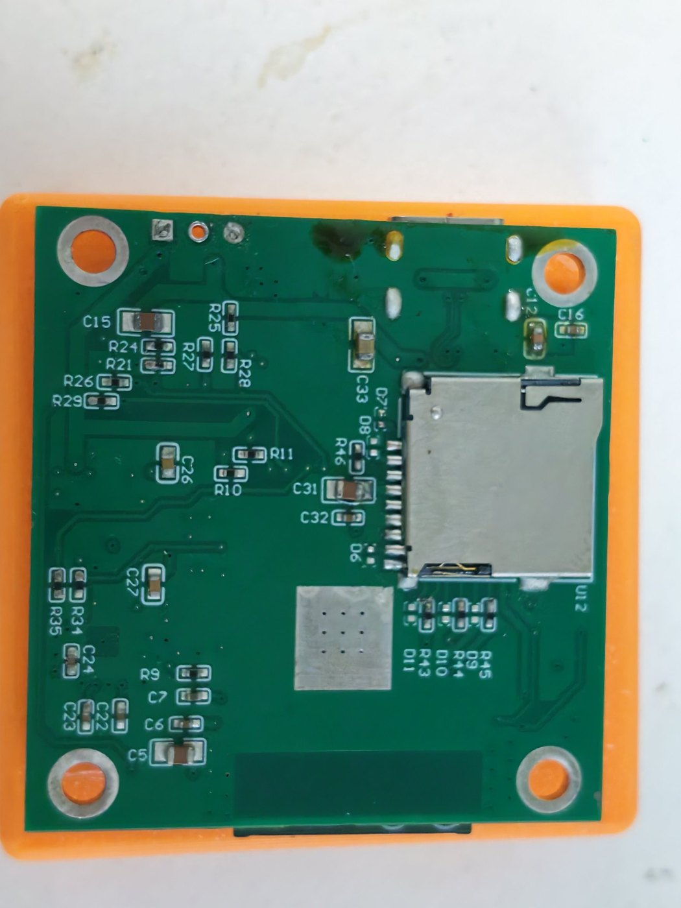
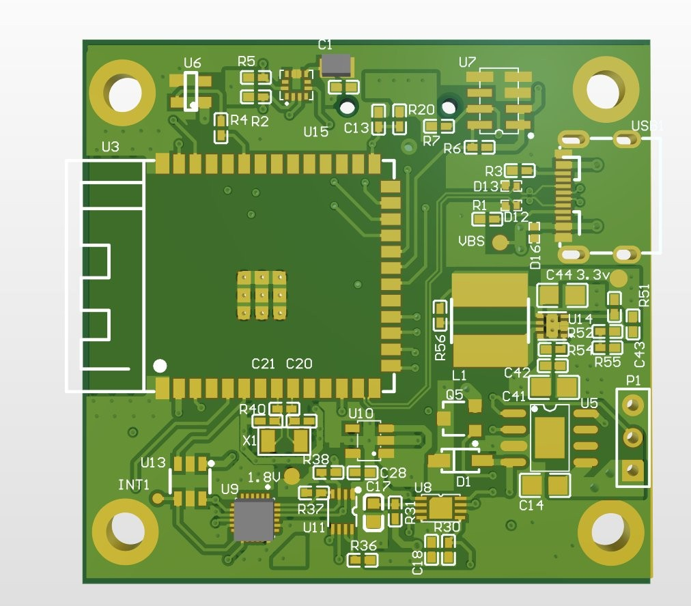
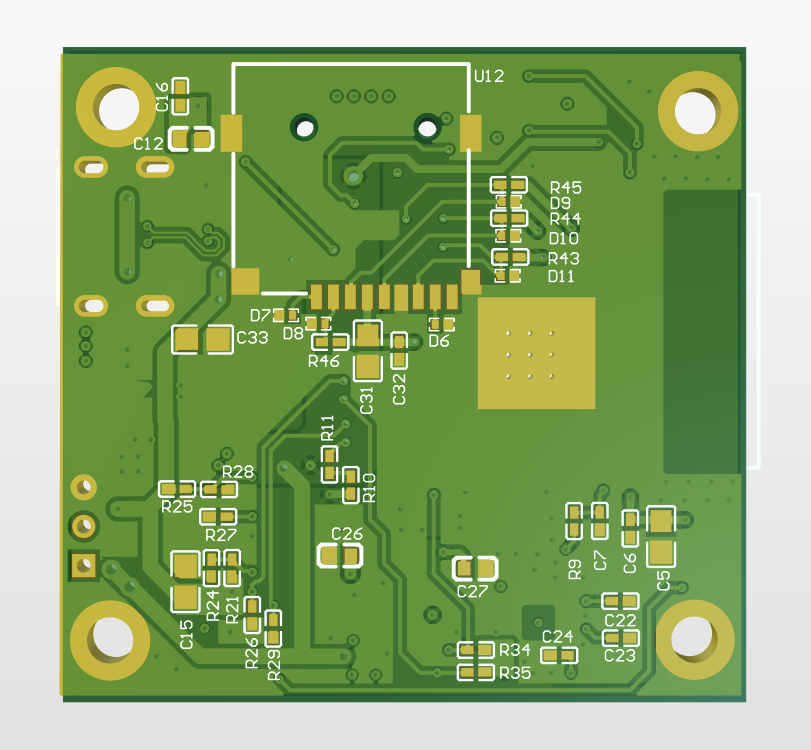
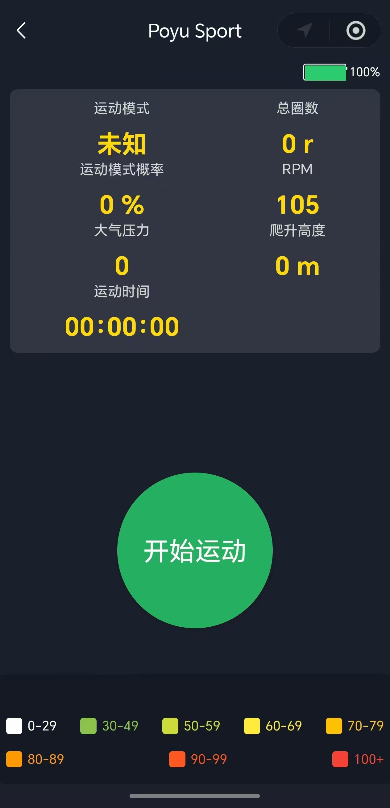

# Smart Wear · ESP32-S3 端侧运动识别

这是一个可运行的 ESP32-S3 可穿戴固件与训练管线：采集 IMU / 气压计 / 电量等数据，在设备端用 TensorFlow Lite Micro 做 **4 类运动识别**（其他 / 步行 / 骑行 / 跑步），通过 BLE 上报状态，也支持 Wi-Fi AP + WebSocket 调试。

> 这是 **开源版本**：包含固件、模型、训练脚本，以及 ESP32-S3 的 Altium 硬件工程（`hardware/`）。
> 原始采集数据、数据手册、厂商安装包和构建产物 **不在本仓库中**。

## 功能

- **ESP32-S3 + PSRAM**，ESP-IDF 5.3.1，16 MB Flash，OTA 双分区
- **传感器**：ICM-20948 / MPU-9250 / SC7A22H 驱动、MS5611 气压计、MAX17043 电量计、SD 卡、OLED、EEPROM
- **端侧推理**：12 维特征 × 75 帧窗口，Conv1D + LSTM + 统计分支，TFLite Micro
- **两种模型**：float32 与 int8（由 `TFLITE_INT8_NORMALIZE_FLAG` 选择）
- **通信**：BLE TLV 协议（Canonical Protocol v1-Lite）、Wi-Fi SoftAP + WebSocket
- **低功耗**：ULP RISC-V 协处理器加速度唤醒
- **训练管线**：数据加载、窗口切分、训练、剪枝、量化、TFLite 转换、评估

## 硬件

- ESP32-S3-WROOM-1 模组、USB-C、microSD 卡座、IMU、气压计、电量计
- Altium 工程、实物照片、PCB 版图与外壳（正面/反面 STL）见 [hardware/](hardware/)

<table>
<tr>
<td align="center"><br>实物正面</td>
<td align="center"><br>实物背面</td>
</tr>
<tr>
<td align="center"><br>PCB 顶层（元件面）</td>
<td align="center"><br>PCB 底层（SD 卡座面）</td>
</tr>
</table>

## 测试前端（微信小程序）



配套测试前端是微信小程序 **Poyu Sport**：连接广播名 `POYUSPORT` 的设备，Service / Characteristic UUID 见 [docs/FRONTEND.md](docs/FRONTEND.md)。小程序闭源、不在本仓库；没有小程序时可用 nRF Connect / LightBlue 按同一 UUID 测试。

## 目录结构

```text
smart_wear_open/
├── CMakeLists.txt
├── partitions.csv
├── sdkconfig.defaults          # 从原工程导出的构建配置
├── main/
│   ├── main.cpp / Initialize.cpp
│   ├── include/                # 传感器、算法、AI、任务头文件
│   ├── src/                    # C++ 实现
│   ├── ulp/                    # ULP RISC-V 唤醒程序
│   ├── tusb/                   # TinyUSB 描述符
│   ├── scripts/ulp_build.py
│   └── idf_component.yml
├── components/                 # 第三方库，保留各自 LICENSE
├── training/                   # 训练 / 量化 / 评估脚本
├── models/model_12feat.tflite  # 参考模型
├── docs/
│   ├── protocol.md             # BLE TLV 协议
│   ├── FRONTEND.md             # 微信小程序测试说明
│   ├── BUILD.md                # 编译与烧录
│   └── DATASET.md              # 数据格式与标注
└── hardware/                   # Altium 工程 + 库，CERN-OHL-W-2.0
```

## 快速开始

环境：ESP-IDF **5.3.1**（或兼容的 5.3.x），Python 3.10+。

```bash
git clone <this-repo> smart_wear_open
cd smart_wear_open
idf.py set-target esp32s3
idf.py build
idf.py -p COMx flash monitor
```

首次构建会通过 `main/idf_component.yml` 拉取 `arduino-esp32`、`esp-sr`、`esp-dsp` 等托管组件，需要网络。`managed_components/` 和 `build/` 已被忽略。

详细步骤见 [docs/BUILD.md](docs/BUILD.md)。

## 模型与推理

- 输入：`[1, 75, 12]`，float32（int8 变体为对应量化输入）
- 输出：`[1, 4]`，softmax：`0 其他 / 1 步行 / 2 骑行 / 3 跑步`
- 特征：`roll, pitch, accel_x/y/z, gyro_x/y/z, vert_line_accel, accel_mag, hor_accel, vert_percent`（12 维；`TF_LITE_USE_PARAMETER_13=1` 时为 13 维含 yaw）
- 窗口：75 帧，步长 40；同一窗口内标签必须一致

`main/SW_define.h` 里两个开关：

```c
#define ENABLE_DEDUCTION_FLAG       1   // 1: 推理；0: 采集
#define TFLITE_INT8_NORMALIZE_FLAG  0   // 1: int8 模型；0: float32 模型
```

切换 int8 时，需要用 `training/` 里的量化脚本重新生成 `model_io_int8.h`。

## 训练与量化

```powershell
cd training
python -m venv .venv
.venv\Scripts\activate
pip install -r requirements.txt

$env:TRAIN_DATA = "<train_data_dir>"
python Quantization_Conv1D_LSTM.py

$env:EVAL_DATA = "<test_data_dir>"
$env:TFLITE_MODEL = ".\models\model_12feat.tflite"
python eval_tflite.py
```

数据格式、目录命名和标签规则见 [docs/DATASET.md](docs/DATASET.md) 与 [training/README.md](training/README.md)。

## BLE 协议

`docs/protocol.md` 定义了帧格式（`0xAA 0x55` 起始、TLV、CRC16-CCITT-FALSE）和 `STATE` / `TELEMETRY` / `CONTROL` 等消息。枚举里预留了 6 类运动，当前模型只输出 4 类。

## 已知限制

- 这是**研究/学习用途**的参考实现，不是医疗设备，也不构成健康建议。
- 分类准确率取决于采集数据、佩戴位置和设备姿态；仓库不包含原始数据集，无法直接复现论文级指标。
- 当前只支持 4 类运动，不识别羽毛球动作、跌倒或具体活动类型。
- SoftAP 默认密码是演示值（`11111111`），WebSocket 没有鉴权，只应在可信网络中使用；正式产品请改为配网 + 鉴权。
- 部分历史注释/命名保留了原工程的写法，欢迎 PR 清理。
- 硬件工程只含 Altium 源文件，不含 Gerber / BOM / 坐标文件；3D 模型链接已脱敏，打开时可能提示缺失，重新链接即可。
- 硬件版本为 `版本18_four`：原理图 2026-01-07、PCB 2026-01-06；打样前请在 Altium 中重新编译并跑 DRC。

## 许可证

- 本项目原创固件与训练代码：**Apache License 2.0**，见 [LICENSE](LICENSE)。
- `components/` 与构建时拉取的组件：各自许可证（MIT / BSD / Apache-2.0 / MPL-2.0 / LGPL-2.1 / LGPL-3.0），**整个仓库不是单一的 Apache-2.0**。详见 [THIRD_PARTY_NOTICES.md](THIRD_PARTY_NOTICES.md)。
- AsyncDelay、SoftWire、ESPAsyncWebServer、AsyncTCP 和 Arduino-ESP32 为 LGPL：只发布源码时保留声明即可；发布固件二进制或售卖设备时，还需满足 LGPL 的源码提供与可重新链接义务（AsyncTCP 是 LGPL-3.0，另有安装信息要求）。
- 模型权重：随本项目以 Apache-2.0 提供；训练数据不在仓库内。
- 硬件设计：`hardware/` 下的 Altium 工程，**CERN-OHL-W-2.0**，见 [hardware/LICENSE](hardware/LICENSE)。
- “POYU / 泊宇”名称与标识不随代码授权。

## 贡献

欢迎 issue / PR：驱动适配、量化精度、更多运动类别、文档与注释清理。提交前请确保不包含个人数据、密钥或厂商版权资料。
