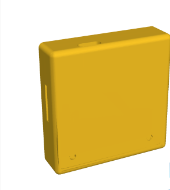
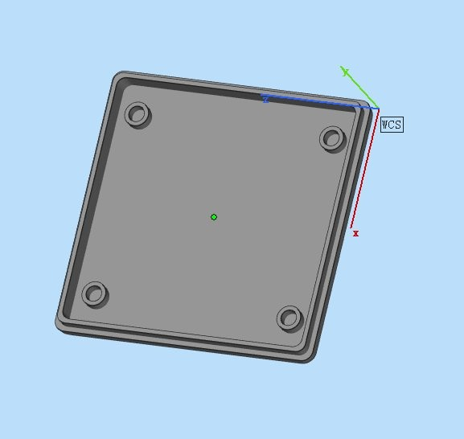
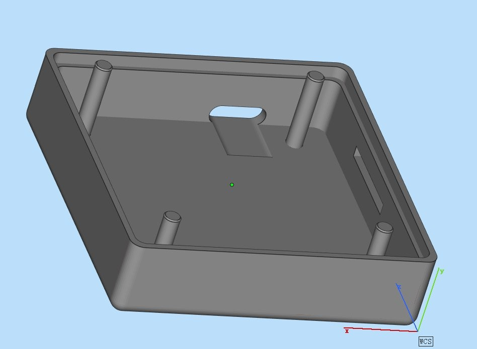

# 外壳：POYU Pocket Tag

58 × 47 mm 口袋标签外壳，提供正面 / 反面两个 STL，可直接切片打印。

## 外观

<table>
<tr>
<td align="center"> 装配图（黄色为渲染配色）</td>
<td align="center"> 外壳外部（四角螺丝孔）</td>
<td align="center"> 外壳内部（四角立柱，固定 PCB）</td>
</tr>
</table>

## 文件

| 文件 | 说明 |
|---|---|
| `正面.STL` | 正面壳 |
| `反面.STL` | 反面壳 |

## 打印

- 两个 STL 可分别切片；材料、层高、支撑和公差没有做正式验证。
- 建议先打印反面壳，核对 PCB、电池、microSD 卡座和 USB-C 开口的干涉，再打印正面壳。
- 四角为固定立柱，用于把 PCB/主板固定在外壳内；螺丝规格以模型内孔为准，仓库不提供紧固件清单。
- 整机外形约 58 × 47 × 12–13 mm，以模型为准。
- 没有做跌落、防水、佩戴舒适性验证。

## 装配

- 正面壳与反面壳通过四角螺丝固定，唇边/配合以模型为准。
- 命名沿用原设计文件；“正面 / 反面”与 PCB 元件面、电池面的对应关系请按实物确认。

## 许可证

外壳设计文件与 `hardware/` 下其他硬件文件一样，使用 **CERN-OHL-W-2.0**，见 [../LICENSE](../LICENSE)。

## 说明

- 这些文件来自实际打样迭代，不是量产结构设计。
- 修改外壳时请保留版本号和变更说明；不要提交 SolidWorks 临时文件、Toolbox 缓存或个人路径。
